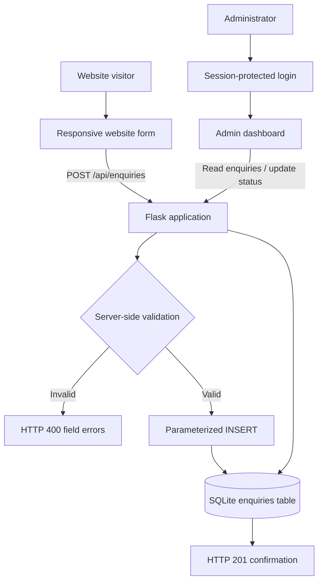

# Architecture and data flow

## Data model

`enquiries`

| Field | Type | Purpose |
|---|---|---|
| id | INTEGER PRIMARY KEY | Unique enquiry identifier |
| name | TEXT NOT NULL | Contact name |
| email | TEXT NOT NULL | Reply address |
| organisation | TEXT | Organisation name, optional |
| enquiry_type | TEXT NOT NULL | Sample / technical / partnership / general |
| subject | TEXT NOT NULL | Short enquiry title |
| message | TEXT NOT NULL | Enquiry body |
| status | TEXT NOT NULL | New, In Progress, Responded or Closed |
| created_at | TEXT NOT NULL | UTC timestamp generated by SQLite |

## Request lifecycle

1. `GET /` serves the public website.
2. Browser JavaScript submits `FormData` to `POST /api/enquiries`.
3. Flask validates fields and rejects malformed values.
4. SQLite stores valid values with a parameterised SQL statement.
5. `GET /admin/login` authenticates the configured demo administrator.
6. `GET /admin` lists stored records for an authenticated session.
7. `POST /admin/enquiries/<id>/status` updates the selected status.

## Production evolution

Replace the local SQLite file with managed PostgreSQL, use a dedicated identity provider, add CSRF protection and rate limiting, send notifications through an approved transactional email service, and deploy behind HTTPS/WAF with centralised logs, monitoring and backups.
